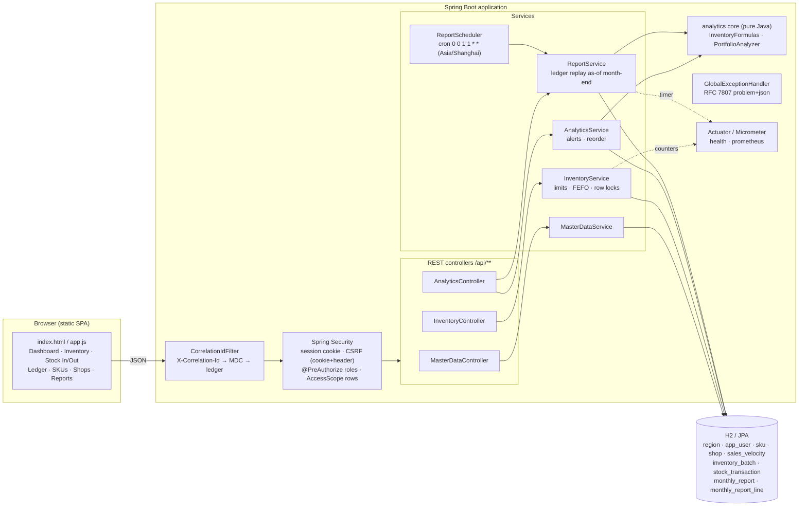
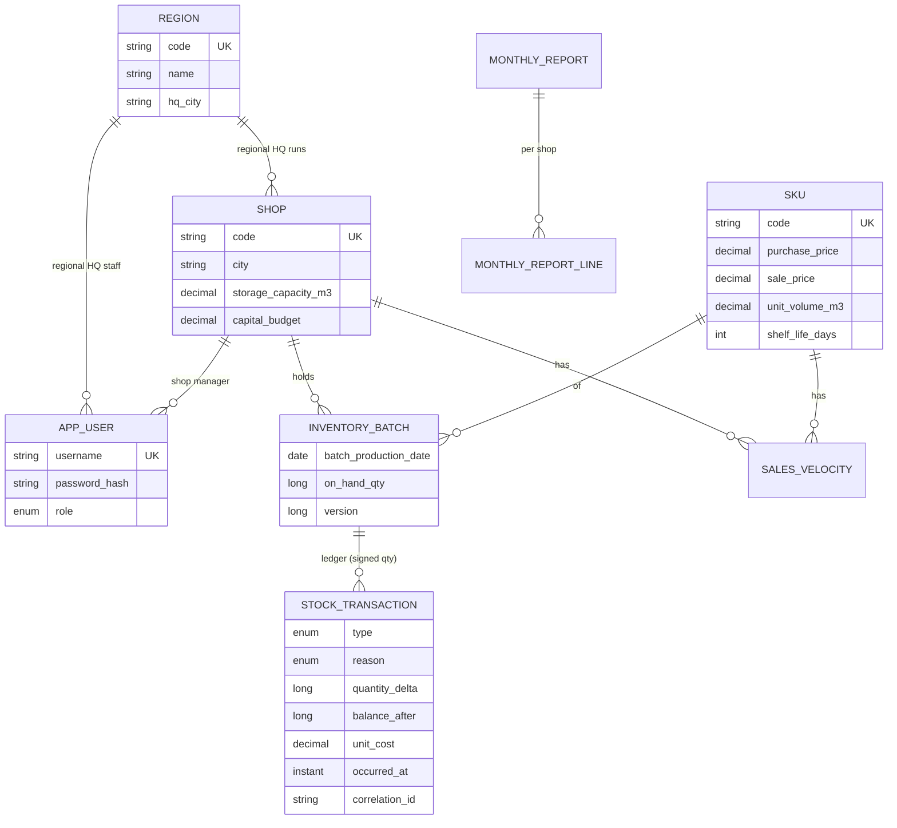

# Product Inventory Management — Hackathon BE2

Regional HQ system that manages product inventory for a China convenience-store chain: **33 shops across 11 cities in 4 regions**, priced in RMB (¥) and running on China Standard Time. It covers regions, SKU and shop master data, Stock-In / Stock-Out with storage and capital-budget limits, batch-level depreciation risk, an automated **Monthly Management Report** with trends, and a **节日备货 festival pre-stock planner** (双十二, 冬至, 平安夜, 春节). Access is role-based: group HQ, regional HQ and shop manager.

**Stack:** Java 21 · Spring Boot 3.4 (Web, Data JPA, Validation, Security, Actuator, Scheduling) · H2 (file DB; JPA makes it swappable for Postgres) · Micrometer/Prometheus · vanilla JS + Chart.js front end (bundled locally, works offline).

| Acceptance criterion | Status | Where |
|---|---|---|
| (Mandatory) Elementary information management: SKU and shop | ✅ CRUD, validation, unique codes, soft-deactivate; shops belong to a **Region** (regional HQ) | `MasterDataService`, UI **Regions** / **SKUs** / **Shops** tabs |
| (Mandatory) On-going inventory management: Stock-In / Stock-Out, analysis and observability | ✅ Ledger, FEFO, limits, alerts, metrics, correlation ids | `InventoryService`, `AnalyticsService`, UI **Stock In / Out**, **Ledger**, **Inventory**, **Dashboard** |
| (Optional plus) Monthly management report: automated batch, valuation / turnover / depreciation across all shops, with trend | ✅ `@Scheduled` batch, point-in-time rebuild from the ledger, regional subtotals, CSV export | `ReportService`, `ReportScheduler`, UI **Reports** |
| *(Beyond the brief)* Festival pre-stock planning | ✅ Per-shop recommendations for upcoming Chinese retail events, timed to stay NORMAL tier and sized by last season's sell-through | `FestivalPlanner`, `FestivalCalendar`, UI **节日备货 Festivals** |

---

## Run it

```bash
mvn spring-boot:run              # or: mvn package && java -jar target/inventory-management-1.0.0.jar
open http://localhost:8080       # UI
```

On first start against an empty DB, `DataSeeder` builds the China demo dataset described in **Demo data** below and simulates about 7 months of trading through the real `InventoryService`, so every business rule is applied. It then back-fills 6 monthly reports so the trend view has history. This takes about 40 seconds, once. To reset, delete `./data/`. **Delete it when upgrading from an older build**, because the schema and data changed. To turn seeding off, set `app.seed.enabled=false`.

### Demo data

The data is **synthetic but modelled on a Chinese convenience-store / community-supermarket chain**. It is generated deterministically (fixed random seed), so every run gives the same numbers.

| | |
|---|---|
| **Regions (regional HQs)** | 华东 East China (HQ 上海 Shanghai) · 华南 South China (HQ 广州 Guangzhou) · 华北 North China (HQ 北京 Beijing) · 西南 Southwest (HQ 成都 Chengdu) |
| **Cities → shops** | Shanghai, Hangzhou, Nanjing, Suzhou · Guangzhou, Shenzhen, Dongguan · Beijing, Tianjin · Chengdu, Chongqing. Three shops per city, named by district (e.g. `SH-01 静安店 Jing'an`, `SZ-02 南山店 Nanshan`, `CD-02 高新店 Hi-tech Zone`) |
| **SKUs (21, generic, no brands)** | 鲜牛奶 fresh milk (7-day life), 鲜肉包 pork buns (3 days), 嫩豆腐 tofu, 鲜鸡蛋 eggs, 东北大米 Northeast rice, 花生油 peanut oil, 方便面 instant noodles, 生抽 soy sauce, 辣椒油 chili crisp, 无糖乌龙茶 sugar-free oolong, 饮用水 bottled water, 白酒 baijiu (10-year life, ¥268), 速冻水饺 frozen dumplings, 汤圆 tangyuan, 瓜子 sunflower seeds, **月饼礼盒 mooncake gift box** (60-day life), **平安果礼盒 Christmas Eve apple gift box** (21-day life, ranged but not yet sold this year), 抽纸 tissues, 洗衣液 laundry liquid, 牙膏 toothpaste, 常温酸奶 ambient yogurt |
| **Prices** | RMB at typical tier-1 city shelf prices, with 33–51% gross margin. Charts use 万 / 亿 units |
| **Shop limits** | Storage m³ and capital budget sized from each shop's expected working stock; about a quarter of shops are deliberately tight |
| **Timeline** | About 7 months to "yesterday". Restocking cycles match shelf life (buns every 2 days, rice every 2 weeks), plus occasional damage, expiry write-offs and bulk "promo" buys of long-life goods |

**Built-in China retail events** (so the analytics have something real to find):
- **中秋 Mid-Autumn Festival (25 Sep 2026):** every shop stocks up on mooncake gift boxes from 6 weeks out, often over-ordering. Demand stops dead on the day. About 30% of shops return leftovers to the supplier, 30% write them off once they expire, and the rest still hold them. Result: **¥52.6k of expired mooncakes, about 81% of the group's depreciation provision**. Inventory value peaks in August, and mooncakes are the top CRITICAL alerts.
- **双十一 Double 11 (1–11 Nov):** demand for tissues, laundry liquid, toothpaste and bottled water rises about 1.7×.
- Fresh food (milk, buns, tofu) produces the steady stream of small EXPIRED / EXPIRING alerts any real store has.

### 节日备货 Festival pre-stock planner (it's almost Christmas)

"Today" in the demo is 22 Nov 2026, so the planner looks at the next 90 days of the Chinese retail calendar:

| Event | Date | What lifts | Why it's relatable |
|---|---|---|---|
| 双十二 Double 12 | 12 Dec | Tissues, laundry liquid, toothpaste, water ×1.4–1.5 | Second shopping festival after 双十一 |
| 冬至 Winter Solstice | 22 Dec (the solstice falls at 04:50 Beijing time) | **North: dumplings ×3.5 · East / South / Southwest: tangyuan ×3.5** | 北方吃饺子，南方吃汤圆: a regional HQ difference the planner honours per region |
| 平安夜 Christmas Eve | 24 Dec | **平安果 gift-wrapped apples** (a one-off seasonal SKU) | 苹果 "ping" echoes 平安 (peace): the Chinese Christmas Eve gift |
| 春节 Spring Festival | 6 Feb 2027 | Baijiu ×4, peanut oil ×2.5, rice ×2, sunflower seeds ×3, dumplings, water | The year's biggest stock-up |

How each line is worked out (`FestivalPlanner`):
- **Regular SKUs:** extra units = the shop's velocity × (uplift − 1) × window days, on top of normal replenishment.
- **One-off seasonal SKUs (平安果):** forecast = 25/day × the shop's traffic index × 3 days, minus stock still sellable on the day. It is then **scaled by the region's sell-through on last season's mooncakes, learned from the ledger** (about 80% in every region), so the mooncake overstock isn't repeated.
- **Receive window:** *from* = festival end − ⌊0.6 × shelf life⌋, so the batch is still **NORMAL tier (R<sub>dep</sub> < 0.60, 0% provision) on the last festival day**. *By* = 2 days before the window opens. For 21-day apples that's 12–20 Dec.
- **Limits:** every line is capped by the shop's remaining storage m³ and capital budget, which are consumed line by line. Capped lines are flagged.
- **Scope:** a shop manager sees only their shop's plan, and a regional HQ only its region. Every role gets the same numbers for the same shop.

Each line has a **Stock-in** button that pre-fills the Stock-In form.

### Demo logins

All seeded accounts use the password `demo1234` (set by `app.seed.demo-password`; stored as bcrypt). The sign-in screen lists them, and selecting one fills in the form.

| Username | Role | Sees and manages |
|---|---|---|
| `hq.admin` | **Group HQ** (`HQ_ADMIN`) | Everything. The only role that can edit regions and the SKU catalogue and run the monthly batch |
| `rhq.east` | **Regional HQ** (`REGION_MANAGER`), 华东 East China, Shanghai | Its 12 shops: shops, limits, velocities, stock, reports |
| `rhq.south` | Regional HQ, 华南 South China, Guangzhou | Its 9 shops |
| `rhq.north` | Regional HQ, 华北 North China, Beijing | Its 6 shops |
| `rhq.sw` | Regional HQ, 西南 Southwest China, Chengdu | Its 6 shops |
| `shop.sh01` / `shop.gz01` | **Shop manager** (`SHOP_MANAGER`): 上海静安店 / 广州天河店 | One shop: dashboard, inventory, stock in/out, ledger, alerts. Read-only master data, no reports |

For a real deployment with seeding off, set `APP_SECURITY_BOOTSTRAP_ADMIN_PASSWORD` to create the first `hq.admin` on an empty database.

Other endpoints (HQ admin only, except health): `/h2-console` (JDBC URL `jdbc:h2:file:./data/inventory`), `/actuator/health`, `/actuator/prometheus`.

## Test it

```bash
mvn test                          # 53 tests: unit, integration, API, security and festival planner
node e2e/screenshots.js           # with the app running: browser e2e + regenerates docs/screenshots
```

| Suite | What it proves |
|---|---|
| `InventoryFormulasTest` (18) | Each reference formula; **every R<sub>dep</sub> tier boundary** (0.5999 / 0.60 / 0.8499 / 0.85 / 1.00 inclusive in HIGH / 1.0001); provision rates; ε stops division by zero on empty inventory |
| `PortfolioAnalyzerTest` (2) | A fully hand-computed, two-shop worked example (V<sub>cost</sub>, V<sub>retail</sub>, COGS, turnover, provision, NRV, volume, utilisation) |
| `InventoryServiceIntegrationTest` (11) | Capacity and budget rejection (with max acceptable qty); expired-on-arrival; future production date judged on the business clock; FEFO allocation; sales skip expired stock; write-off; batch ownership; **12 concurrent stock-outs never oversell**; **12 concurrent stock-ins never breach storage and never duplicate a batch** |
| `ReportServiceIntegrationTest` (5) | Report rebuilds inventory **as at month-end from the ledger** (Sep / Oct / Nov checked by hand); regeneration is idempotent; future periods are rejected; scheduler targets the previous month; budget-aware reorder suggestion; **CSV neutralises spreadsheet formula injection** |
| `FestivalCalendarTest` (4) | Calendar dates in Beijing time; apples received on *from* are NORMAL tier on 24 Dec and one day earlier would be MODERATE; long-life goods can be ordered now; 冬至 is regional |
| `FestivalPlannerIntegrationTest` (4) | Hand-computed plans: north pre-stocks 20 dumplings and the east 10 tangyuan; apples sized 75 → 57 by the region's 75% mooncake sell-through; budget cap; role scoping |
| `ApiIntegrationTest` (3) | REST contract: 201/400/404/422 problem responses, correlation-id propagation, ledger filters, analytics numbers, region subtotals, CSV, health, metrics |
| `SecurityIntegrationTest` (5) | **Role and row-level scoping**: anonymous → 401; group HQ sees both regions with subtotals that add up; a regional HQ sees only its region (shops, ledger, analytics, report totals, CSV) and can't open shops elsewhere, edit SKUs or run the batch; a shop manager sees and moves only its own shop; missing CSRF token → 403 |
| `LoginFlowHttpTest` (1) | The browser's real HTTP flow on a random port: XSRF cookie → bad password 401 → login → HttpOnly session cookie → API → logout → 401 |
| `e2e/screenshots.js` (27 checks) | Real browser, signed in as each role: sign-in screen and bad password; the shop manager's single-shop view with no Reports/Regions tabs; the regional HQ's region-only dashboard and report; group HQ dashboard, regions, festival plan (four events, 中秋 lesson, 平安果 lines), the shop manager's own-shop festival plan, tier filter, stock-in, oversell rejected, ledger, ≥ 6-month trend, dark theme, phone width, zero console errors |

Tests run against an in-memory DB with the clock fixed to `2026-11-22 10:00` China Standard Time, so they are deterministic.

---

Independent review findings and their fixes are in [`docs/REVIEW.md`](docs/REVIEW.md).

## Where is the Regional HQ?

It is modelled explicitly at two levels:

1. **`Region`**: a regional HQ (code, name, HQ city). Every `Shop` belongs to exactly one region. The dashboard, Regions page and monthly report roll shops up into **regional subtotals**. Turnover is recomputed from summed COGS and cost, not averaged across shops.
2. **Roles (`AppUser`)**: *Group HQ* owns the SKU catalogue, the regions and the monthly batch. A *Regional HQ* user manages the shops, limits and velocities of its own region. A *Shop manager* runs one shop. Every API call is filtered to the caller's scope on the server (`CurrentUser` → `AccessScope`), not just hidden in the UI.

The SKU catalogue is intentionally group-wide (one price list), and shop limits are set by HQ. That matches the brief's "Regional HQ centrally manages product inventory".

## Architecture



### Domain model



### Key design decisions

1. **Batch-level stock.** Depreciation depends on `batch_production_date`, so stock is held per (shop, SKU, batch) rather than as a single counter. This enables FEFO and per-batch provisions.
2. **Immutable, signed ledger.** Every movement is a `stock_transaction` (+in / −out) with `balance_after`. The balance at any moment is `Σ quantity_delta WHERE occurred_at ≤ t`, so the monthly report can be **regenerated for any closed month** from history, not just from a snapshot taken on the night.
3. **One calculation engine.** `PortfolioAnalyzer` is pure Java with no Spring or DB. The live dashboard and the monthly batch both call it, so the two always agree, and it is unit-testable with hand-computed numbers.
4. **Concurrency safety.** Every stock movement first takes a `PESSIMISTIC_WRITE` lock on its **shop row**, so movements at one shop run one at a time and different shops run in parallel. This makes the limit checks and batch find-or-create race-free. Stock-out also locks candidate batches, a unique constraint on (shop, SKU, batch number) is a database backstop, and `@Version` gives a 409 `CONCURRENT_UPDATE`. Covered by two 12-thread tests.
5. **Rules are checked before any write.** Capacity, budget, expired-on-arrival and insufficient stock are validated first. Failures return 422 with machine-readable `details` (for example `maxAcceptableQty`), and the UI shows them.
6. **Money uses `BigDecimal`** (scale 2, HALF_UP). Ratios use `double`.
7. **Time is injected through `Clock`** in Asia/Shanghai (CST, UTC+8), which makes tests deterministic and runs the cron on China time.
8. **Security in two layers.** Roles are checked with `@PreAuthorize` (for example, only group HQ edits SKUs). Row-level scope is enforced by `AccessScope` in every controller, covering reads, writes, analytics, ledger, reports and CSV. Report totals are **re-aggregated from the visible lines**, so a regional HQ never sees group totals.
9. **SPA auth done properly.** Session cookie (`HttpOnly`, `SameSite=Lax`), session-id rotation on login, CSRF via the `XSRF-TOKEN` cookie plus `X-XSRF-TOKEN` header (token rotated on login), bcrypt passwords, and JSON 401/403 problem responses instead of browser pop-ups.

### Formulas (from the brief) → code

| Brief | Implementation |
|---|---|
| V<sub>cost</sub> = Σ(on_hand_qty × purchase_price) | `InventoryFormulas.lineValue` summed in `PortfolioAnalyzer` |
| V<sub>retail</sub> = Σ(on_hand_qty × sale_price) | same |
| COGS<sub>30d</sub> = daily_sales_velocity × 30 × purchase_price | `InventoryFormulas.cogs30d`, summed per shop over its SKUs |
| Turnover = COGS<sub>30d</sub> / (V<sub>cost</sub> + ε), ε = 10⁻⁶ | `InventoryFormulas.turnoverRate` |
| Elapsed days = current date − batch_production_date | `InventoryFormulas.elapsedDays` |
| R<sub>dep</sub> = elapsed / shelf_life_days | `InventoryFormulas.shelfLifeConsumptionRatio` |
| Normal < 0.60 → 0% · Moderate 0.60–<0.85 → 25% · High 0.85–≤1.00 → 60% · Expired > 1.00 → 100% | `RiskTier.classify` / `RiskTier.provisionRate` |

**Velocity source.** The live dashboard uses each shop's configured historical `daily_sales_velocity` (editable in the Shops tab). Monthly reports use the velocity **observed in the ledger** (SALE units in the 30 days to month-end ÷ 30), so each month's turnover reflects what actually happened that month.

### Beyond the brief (analysis and observability)

- **Alerts:** expired, expiring (HIGH tier), stock-out, low cover (< 3 days), overstock (> 90 days), storage or budget ≥ 90%.
- **Reorder suggestions:** order up to 21 days of cover, **capped by the shop's remaining storage m³ and capital budget**. One click pre-fills Stock-In.
- **Headroom API:** `GET /api/inventory/headroom` returns the maximum receivable qty for a shop and SKU.
- **Net realisable cost** = V<sub>cost</sub> − provision. **Potential gross margin** = V<sub>retail</sub> − V<sub>cost</sub>.
- **Observability:** correlation id on every request and ledger row; structured request logs with latency; Prometheus counters `inventory_movements_units_total{type,reason}`; timer `inventory_report_generation`; health with DB details.

## REST API

| Method | Path | Purpose |
|---|---|---|
| POST | `/api/auth/login` · `/api/auth/logout` | sign in / out (session cookie) |
| GET | `/api/auth/me` | current user, role and scope |
| GET/POST | `/api/regions` | list (scoped) / create region (group HQ) |
| GET/PUT/DELETE | `/api/regions/{id}` | read / update / deactivate (group HQ; blocked while active shops remain) |
| GET/POST | `/api/skus` | list / create SKU |
| GET/PUT/DELETE | `/api/skus/{id}` | read / update / deactivate (blocked while stock is on hand) |
| POST | `/api/skus/{id}/activate` | reactivate |
| GET/POST | `/api/shops?regionId=` | list (scoped, with live utilisation) / create shop (group HQ, or regional HQ in its own region) |
| GET/PUT/DELETE | `/api/shops/{id}` | read / update (capacity and budget can't go below current usage) / deactivate |
| GET | `/api/shops/{id}/velocities` | velocity, on hand and days of cover per SKU |
| PUT | `/api/shops/{id}/velocities/{skuId}` | set daily sales velocity |
| POST | `/api/inventory/stock-in` | `{shopId, skuId, quantity, batchProductionDate, batchNo?, reference?, note?}` |
| POST | `/api/inventory/stock-out` | `{shopId, skuId, quantity, reason, batchId?, reference?, note?}`; reason ∈ SALE, DAMAGE, EXPIRED_WRITE_OFF, TRANSFER_OUT, RETURN_TO_SUPPLIER, STOCKTAKE_ADJUSTMENT |
| GET | `/api/inventory/batches?shopId=` | batches with R<sub>dep</sub>, tier and provision |
| GET | `/api/inventory/headroom?shopId=&skuId=` | max receivable qty |
| GET | `/api/inventory/transactions?shopId=&skuId=&type=&page=&size=` | ledger (paged) |
| GET | `/api/analytics/portfolio?regionId=&includeBatches=` | total, **per-region** and per-shop valuation, turnover, depreciation (scoped) |
| GET | `/api/analytics/alerts?regionId=` | prioritised alerts with reorder qty, ranked by value at risk (scoped) |
| GET | `/api/analytics/festival-plan?horizonDays=&regionId=` | 节日备货 festival pre-stock plan and the 中秋 sell-through lesson (scoped) |
| GET | `/api/reports` | report history (trend) with regional subtotals. Group or regional HQ only |
| GET | `/api/reports/{yyyy-MM}` | report and per-shop lines |
| GET | `/api/reports/{yyyy-MM}/csv` | CSV export |
| POST | `/api/reports/generate?period=yyyy-MM` | manual run of the monthly batch |

Each role gets **only the data in its scope**: 401 when signed out, 403 when outside role or scope. Errors are RFC 7807 `application/problem+json` with `code`, `detail`, `correlationId`, plus `details` or `errors` where relevant.

## Screenshots

`docs/screenshots/` contains the sign-in screen, the dashboard per role (group HQ light/dark/mobile, regional HQ, shop manager), the Regions page, the festival plan, batch inventory, stock movements (success and rejected oversell), ledger, SKUs, shops with velocity, and monthly reports.

## Submission materials

- Source code: this repo
- Output screenshots: `docs/screenshots/`
- Prompts used with the LLM: [`docs/PROMPTS.md`](docs/PROMPTS.md)
- Architecture diagram: above (Mermaid renders on GitHub)
- 10-minute briefing notes: [`docs/BRIEFING.md`](docs/BRIEFING.md)
