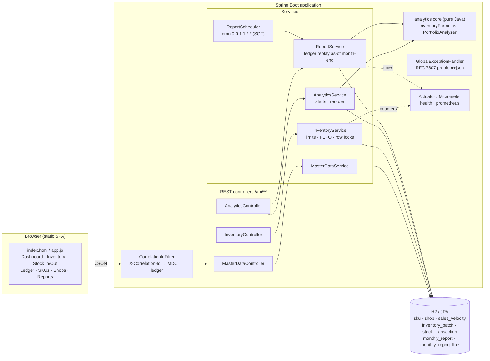
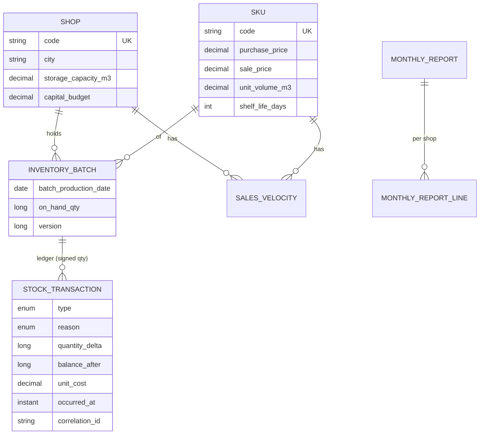

# Product Inventory Management — Hackathon BE2

Regional HQ system that manages product inventory for 24 shops across 6 cities. It covers SKU and shop master data, Stock-In / Stock-Out with storage and capital-budget limits, batch-level depreciation risk, and an automated **Monthly Management Report** with trends.

**Stack:** Java 21 · Spring Boot 3.4 (Web, Data JPA, Validation, Actuator, Scheduling) · H2 (file DB; JPA makes it swappable for Postgres) · Micrometer/Prometheus · vanilla JS + Chart.js front end (bundled locally, works offline).

| Acceptance criterion | Status | Where |
|---|---|---|
| (Mandatory) Elementary information management: SKU and shop | ✅ CRUD, validation, unique codes, soft-deactivate | `MasterDataService`, UI **SKUs** / **Shops** tabs |
| (Mandatory) On-going inventory management: Stock-In / Stock-Out, analysis and observability | ✅ Ledger, FEFO, limits, alerts, metrics, correlation ids | `InventoryService`, `AnalyticsService`, UI **Stock In / Out**, **Ledger**, **Inventory**, **Dashboard** |
| (Optional plus) Monthly management report: automated batch, valuation / turnover / depreciation across all shops, with trend | ✅ `@Scheduled` batch, point-in-time rebuild from the ledger, CSV export | `ReportService`, `ReportScheduler`, UI **Monthly Reports** |

---

## Run it

```bash
mvn spring-boot:run              # or: mvn package && java -jar target/inventory-management-1.0.0.jar
open http://localhost:8080       # UI
```

On first start against an empty DB, `DataSeeder` creates 20 SKUs and 24 shops, then simulates about 7 months of receipts, sales, damage and expiry write-offs (~20k ledger entries) **through the real `InventoryService`**, so every business rule is applied. It then back-fills 6 monthly reports so the trend view has history. This takes about 20 seconds once. To reset, delete `./data/`. To turn seeding off, set `app.seed.enabled=false`.

Other endpoints: `/h2-console` (JDBC URL `jdbc:h2:file:./data/inventory`), `/actuator/health`, `/actuator/prometheus`.

## Test it

```bash
mvn test                          # 36 tests: unit, integration and API
node e2e/screenshots.js           # with the app running: browser e2e + regenerates docs/screenshots
```

| Suite | What it proves |
|---|---|
| `InventoryFormulasTest` (18) | Each reference formula; **every R<sub>dep</sub> tier boundary** (0.5999 / 0.60 / 0.8499 / 0.85 / 1.00 inclusive in HIGH / 1.0001); provision rates; ε stops division by zero on empty inventory |
| `PortfolioAnalyzerTest` (2) | A fully hand-computed, two-shop worked example (V<sub>cost</sub>, V<sub>retail</sub>, COGS, turnover, provision, NRV, volume, utilisation) |
| `InventoryServiceIntegrationTest` (9) | Capacity and budget rejection (with max acceptable qty); expired-on-arrival; FEFO allocation; sales skip expired stock; write-off; batch ownership; **12 concurrent stock-outs never oversell** and the ledger always matches the balance |
| `ReportServiceIntegrationTest` (4) | Report rebuilds inventory **as at month-end from the ledger** (Sep / Oct / Nov checked by hand); regeneration is idempotent; future periods are rejected; scheduler targets the previous month; budget-aware reorder suggestion |
| `ApiIntegrationTest` (3) | REST contract: 201/400/404/422 problem responses, correlation-id propagation, ledger filters, analytics numbers, CSV, health, metrics |
| `e2e/screenshots.js` (9 checks) | Real browser: dashboard, tier filter, stock-in, oversell rejected, ledger, ≥ 6-month trend, dark theme, no horizontal scroll at phone width, zero console errors |

Tests run against an in-memory DB with the clock fixed to `2026-11-22 10:00 SGT`, so they are deterministic.

---

## Architecture



### Domain model



### Key design decisions

1. **Batch-level stock.** Depreciation depends on `batch_production_date`, so stock is held per (shop, SKU, batch) rather than as a single counter. This enables FEFO and per-batch provisions.
2. **Immutable, signed ledger.** Every movement is a `stock_transaction` (+in / −out) with `balance_after`. The balance at any moment is `Σ quantity_delta WHERE occurred_at ≤ t`, so the monthly report can be **regenerated for any closed month** from history, not just from a snapshot taken on the night.
3. **One calculation engine.** `PortfolioAnalyzer` is pure Java with no Spring or DB. The live dashboard and the monthly batch both call it, so the two always agree, and it is unit-testable with hand-computed numbers.
4. **Concurrency safety.** Stock-out takes `PESSIMISTIC_WRITE` locks on candidate batches (`SELECT … FOR UPDATE`), with `@Version` optimistic locking as a backstop (409 `CONCURRENT_UPDATE`). This is covered by a 12-thread test.
5. **Rules are checked before any write.** Capacity, budget, expired-on-arrival and insufficient stock are validated first. Failures return 422 with machine-readable `details` (for example `maxAcceptableQty`), and the UI shows them.
6. **Money uses `BigDecimal`** (scale 2, HALF_UP). Ratios use `double`.
7. **Time is injected through `Clock`** in Asia/Singapore, which makes tests deterministic and keeps the cron in SGT.

### Formulas (from the brief) → code

| Brief | Implementation |
|---|---|
| V<sub>cost</sub> = Σ(on_hand_qty × purchase_price) | `InventoryFormulas.lineValue` summed in `PortfolioAnalyzer` |
| V<sub>retail</sub> = Σ(on_hand_qty × sale_price) | same |
| COGS<sub>30d</sub> = daily_sales_velocity × 30 × purchase_price | `InventoryFormulas.cogs30d`, summed per shop over its SKUs |
| Turnover = COGS<sub>30d</sub> / (V<sub>cost</sub> + ε), ε = 10⁻⁶ | `InventoryFormulas.turnoverRate` |
| Elapsed days = current date − batch_production_date | `InventoryFormulas.elapsedDays` |
| R<sub>dep</sub> = elapsed / shelf_life_days | `InventoryFormulas.shelfLifeConsumptionRatio` |
| Normal < 0.60 → 0% · Moderate 0.60–<0.85 → 25% · High 0.85–≤1.00 → 60% · Expired > 1.00 → 100% | `RiskTier.classify` / `RiskTier.provisionRate` |

**Velocity source.** The live dashboard uses each shop's configured historical `daily_sales_velocity` (editable in the Shops tab). Monthly reports use the velocity **observed in the ledger** (SALE units in the 30 days to month-end ÷ 30), so each month's turnover reflects what actually happened that month.

### Beyond the brief (analysis and observability)

- **Alerts:** expired, expiring (HIGH tier), stock-out, low cover (< 3 days), overstock (> 90 days), storage or budget ≥ 90%.
- **Reorder suggestions:** order up to 21 days of cover, **capped by the shop's remaining storage m³ and capital budget**. One click pre-fills Stock-In.
- **Headroom API:** `GET /api/inventory/headroom` returns the maximum receivable qty for a shop and SKU.
- **Net realisable cost** = V<sub>cost</sub> − provision. **Potential gross margin** = V<sub>retail</sub> − V<sub>cost</sub>.
- **Observability:** correlation id on every request and ledger row; structured request logs with latency; Prometheus counters `inventory_movements_units_total{type,reason}`; timer `inventory_report_generation`; health with DB details.

## REST API

| Method | Path | Purpose |
|---|---|---|
| GET/POST | `/api/skus` | list / create SKU |
| GET/PUT/DELETE | `/api/skus/{id}` | read / update / deactivate (blocked while stock is on hand) |
| POST | `/api/skus/{id}/activate` | reactivate |
| GET/POST | `/api/shops` | list (with live utilisation) / create shop |
| GET/PUT/DELETE | `/api/shops/{id}` | read / update (capacity and budget can't go below current usage) / deactivate |
| GET | `/api/shops/{id}/velocities` | velocity, on hand and days of cover per SKU |
| PUT | `/api/shops/{id}/velocities/{skuId}` | set daily sales velocity |
| POST | `/api/inventory/stock-in` | `{shopId, skuId, quantity, batchProductionDate, batchNo?, reference?, note?}` |
| POST | `/api/inventory/stock-out` | `{shopId, skuId, quantity, reason, batchId?, reference?, note?}`; reason ∈ SALE, DAMAGE, EXPIRED_WRITE_OFF, TRANSFER_OUT, RETURN_TO_SUPPLIER, STOCKTAKE_ADJUSTMENT |
| GET | `/api/inventory/batches?shopId=` | batches with R<sub>dep</sub>, tier and provision |
| GET | `/api/inventory/headroom?shopId=&skuId=` | max receivable qty |
| GET | `/api/inventory/transactions?shopId=&skuId=&type=&page=&size=` | ledger (paged) |
| GET | `/api/analytics/portfolio?includeBatches=` | region and per-shop valuation, turnover, depreciation |
| GET | `/api/analytics/alerts` | prioritised alerts with reorder qty |
| GET | `/api/reports` | report history (trend) |
| GET | `/api/reports/{yyyy-MM}` | report and per-shop lines |
| GET | `/api/reports/{yyyy-MM}/csv` | CSV export |
| POST | `/api/reports/generate?period=yyyy-MM` | manual run of the monthly batch |

Errors are RFC 7807 `application/problem+json` with `code`, `detail`, `correlationId`, plus `details` or `errors` where relevant.

## Screenshots

`docs/screenshots/` contains the dashboard (light, dark and mobile), batch inventory, stock movements (success and rejected oversell), ledger, SKUs, shops with velocity, and monthly reports.

## Submission materials

- Source code: this repo
- Output screenshots: `docs/screenshots/`
- Prompts used with the LLM: [`docs/PROMPTS.md`](docs/PROMPTS.md)
- Architecture diagram: above (Mermaid renders on GitHub)
- 10-minute briefing notes: [`docs/BRIEFING.md`](docs/BRIEFING.md)
